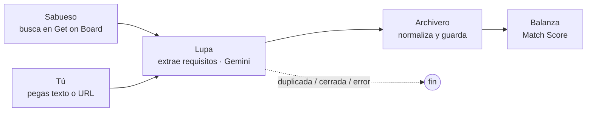
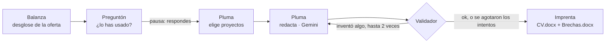

# Job-Intelligence

Asistente personal de búsqueda de empleo para perfiles de datos en Perú. Busca ofertas en fuentes que lo permiten, extrae sus requisitos con Gemini, calcula qué tanto encajas, adapta tu CV **sin inventar nada** y te dice qué estudiar primero.

Está construido como un sistema de **agentes con una sola tarea cada uno**, orquestados con LangGraph, y corre en local con una app de Streamlit.

> Proyecto personal de José Luis Chuque (Ing. de Sistemas, UNMSM). Lo uso en mi propia búsqueda de prácticas en datos.

---

## El problema

Postular bien a una oferta toma tiempo: leerla, ver qué piden, compararlo con lo que sabes y reescribir el CV con su vocabulario. Hacerlo para muchas ofertas lleva a una de dos cosas: mandar el mismo CV a todas, o "adornar" el CV con cosas que no sabes. Este proyecto automatiza lo mecánico y deja las decisiones en tus manos.

## Qué hace

| Módulo | Qué hace |
|---|---|
| **Analizar oferta** | Pegas el texto (y opcionalmente el link), una URL, o la envías desde el navegador con el marcador "Enviar a Job-Intelligence". Extrae puesto, empresa, área, inglés y cada tecnología con su tipo (obligatoria o deseable), su nivel y la frase de la oferta que lo respalda. |
| **Match Score** | Compara la oferta con tu perfil y da un puntaje de 0 a 100, junto con lo que te falta y lo que tienes en un nivel menor al pedido. |
| **Adaptar CV** | Te pregunta por lo que falta, reescribe tu CV con el vocabulario de la oferta y genera dos Word: el **CV listo para enviar** y un **informe de brechas** con qué estudiar y cómo abordarlo en la entrevista. |
| **Bandeja** | Ofertas nuevas que se buscaron solas en Get on Board, ordenadas por Match Score. |
| **Postulaciones** | Estado de cada oferta (Postulada, Entrevista…) con su historial, y **cada versión del CV generada**: al postular queda marcada cuál enviaste, para saber qué tiene la empresa si te llaman. |
| **Qué estudiar** | Ranking de lo que te conviene aprender según tus ofertas, y un plan de estudio con un proyecto por tecnología. |
| **Rutina diaria** | Todas las mañanas busca ofertas, arma un resumen y te avisa con una notificación de Windows. Los lunes actualiza el plan de estudio. |

## Arquitectura

Cada agente tiene **una tarea fija**, con entradas y salidas definidas. Batuta, el orquestador, los conecta en dos grafos de LangGraph.

**Flujo 1: registrar una oferta**



**Flujo 2: adaptar el CV** (con pausa para que respondas)



| Agente | Tarea | ¿Usa Gemini? |
|---|---|---|
| **Batuta** | Orquesta los flujos, las pausas y los reintentos (LangGraph, estado guardado en SQLite) | No |
| **Sabueso** | Busca ofertas en fuentes permitidas, filtra por país, título y seniority, y deduplica | No |
| **Lupa** | Extrae los requisitos con structured output y enums cerrados | Sí |
| **Archivero** | Une tecnologías y empresas con el catálogo (alias, nombre canónico o creación marcada para revisión) | No |
| **Balanza** | Calcula el Match Score y las brechas | No |
| **Preguntón** | Pregunta por cada requisito que no está en tu perfil ni en tu CV, y recuerda tus respuestas | No (plantilla) |
| **Pluma** | Elige y ordena proyectos (Python) y reescribe los textos (Gemini) | Sí |
| **Imprenta** | Genera los DOCX con python-docx | No |
| **Centinela** | Resumen diario, recordatorios de seguimiento y notificación de Windows | No |
| **Brújula** | Calcula qué estudiar primero; Gemini solo redacta el plan | Solo el plan |

Las interfaces (FastAPI y Streamlit) solo llaman a `app/services.py`. Cambiar Streamlit por un frontend en HTML no toca los agentes.

## Decisiones de diseño

- **Si algo se puede calcular, no lo decide el LLM.** El Match Score, la fuente de una oferta, si una tecnología ya existe, qué proyectos van en el CV y qué estudiar primero se calculan en Python. Gemini solo hace lo que es juicio sobre texto: extraer requisitos y redactar.
- **Fórmula del Match Score:** `Σ(peso × crédito) / Σ(peso) × 100`. El peso es 1.0 si la tecnología es obligatoria y 0.5 si es deseable. El crédito es 1.0 si la tienes en el nivel pedido, 0.7 si la tienes en un nivel menor y 0 si no la tienes. El denominador lo define la oferta, así que saber cosas que no piden no sube el puntaje.
- **Pluma no puede inventar.** Solo recibe índices de tus proyectos, así que no puede cambiar nombres, empresas ni fechas. Un validador rechaza el texto si menciona una tecnología que no tienes, una cifra que no está en tu CV o si cambia la estructura. Si después de 2 correcciones sigue fallando, el CV sale con **tus textos originales** y el informe explica por qué.
- **Preguntar antes de escribir.** Lo que la oferta pide y no está en tu CV se pregunta. Solo lo que confirmas puede aparecer en el CV.
- **Prioridad de estudio:** `demanda × distancia × tendencia`. La demanda mide cuántas ofertas la piden; la distancia, si te falta (1), si la tienes en un nivel menor (0.5) o si está en tu CV pero no en tu perfil (0.25). La tendencia compara los últimos 30 días con los 30 anteriores, y solo cuenta si cada periodo tiene al menos 5 ofertas.
- **Datos personales fuera del repo:** el CV base, tus respuestas, los documentos generados y el `.env` están en `.gitignore`. El repo solo trae una plantilla con datos ficticios.

## Hallazgos

Cada hallazgo indica la pregunta, qué se encontró y cómo se comprobó. Datos tomados el **23/10/2026**.

### 1. ¿Cuántas ofertas de datos para Perú hay en fuentes que permiten acceso automático?

**Pocas.** De los portales grandes, solo **Get on Board** ofrece una API pública. LinkedIn e Indeed prohíben el scraping en sus términos, Computrabajo bloquea el acceso automático (responde 403) y Bumeran no tiene API.

Con 5 búsquedas ("analista de datos", "data analyst", "business intelligence", "data engineer", "analytics"), Get on Board devolvió **152 ofertas únicas**:

| Filtro | Ofertas |
|---|---|
| Total devuelto por la API | 152 |
| Ubicadas en Perú | 4 (frente a 70 de Chile) |
| 100% remotas | 72 |
| Con título de datos | 52 |
| … sin cargos senior o lead | 34 |
| **Perú o remotas, de datos y no senior** | **9** |

Además, **50 de las 152 (33%) publican rango salarial**, un dato que en otros portales casi nunca aparece.

*Cómo se comprobó:* conteo directo sobre la respuesta de la API, con los mismos filtros que usa Sabueso (`config/sabueso.yaml`). Es una foto de un día, no una serie de tiempo.

*Conclusión:* un análisis del "mercado laboral de datos en Perú" con fuentes permitidas no tendría muestra suficiente. Por eso el proyecto se enfocó en ayudarme a postular mejor a las ofertas que sí encuentro.

### 2. ¿Se puede adaptar un CV con un LLM sin que invente?

**Sí, con un validador y reglas explícitas; el prompt solo no basta.** En la primera prueba real (una oferta de practicante de BI), el texto de Gemini era fiel, pero tenía dos problemas que el validador no detectaba:

- Escribía las tecnologías en minúsculas ("sql server", "power bi"), porque la lista permitida se le pasaba en minúsculas.
- **Exageraba la participación:** "Participación en la revisión del proceso" pasó a "Revisé el proceso".

Ambos se corrigieron con reglas en el prompt y se verificaron en la siguiente corrida: el texto pasó el validador al primer intento y conservó "Apoyé" y "Participé".

*Cómo se comprobó:* tests con un Gemini falso que inventa una tecnología (Airflow) y una cifra (45%): el validador rechaza ambas, y si la falla persiste el CV sale con los textos originales. Además se revisó el PDF del CV real generado.

### 3. ¿Alcanza el plan gratuito de Gemini?

**Para uso personal sí, pero con un tope que obliga a diseñar alrededor de él:** el plan gratuito permite **20 peticiones al día** con `gemini-3.6-flash`. En la primera corrida de Sabueso, 7 de 8 ofertas fallaron por saturación (503) o por límite (429).

El mensaje del error indica que el límite es **por proyecto y por modelo**, y el panel de cuotas de AI Studio lo confirma. Los modelos Flash tienen 20 peticiones al día, pero los **Flash Lite tienen 500**. Por eso cada agente usa sus propios modelos, en orden de preferencia, y si uno agota su cuota del día pasa al siguiente:

| Agente | Modelos (principal, respaldo) | Peticiones gratuitas al día |
|---|---|---|
| Lupa (extracción, la de más volumen) | `gemini-3.5-flash-lite`, `gemini-3.1-flash-lite` | 500 + 500 |
| Pluma (redacción del CV) | `gemini-3.6-flash`, `gemini-3-flash-preview` | 20 + 20 |
| Brújula (plan semanal) | `gemini-3.8-flash`, `gemini-3.6-flash` | 20 (+ compartido) |

Los modelos se cambian en el `.env`, sin tocar código.

Antes de cambiar el modelo de Lupa se comprobó que extrajera bien. Sobre la misma oferta, el modelo lite encontró las **mismas 8 tecnologías**, con el mismo tipo (obligatoria o deseable), y el mismo título, empresa y área. Solo difirió en 2 niveles, en requisitos que la oferta da como rango ("SQL Intermedio-Avanzado", "Python básico o intermedio"): el lite tomó el extremo bajo y el modelo anterior el alto.

Cambios que salieron de eso:
- Modelos propios por agente, con respaldo, para repartir la cuota gratuita. Con eso el tope de Sabueso pasó de 8 a 30 ofertas por corrida.
- Reintentos con espera solo para errores temporales.
- 6 segundos de pausa entre ofertas.
- Tope de 8 ofertas por día en Sabueso, para dejar margen al uso manual.
- Si se agota la cuota diaria, Sabueso se detiene en lugar de seguir fallando.

*Cómo se comprobó:* registro de la rutina (`data/logs/rutina.log`, con 11 respuestas 429 y 10 respuestas 503) y el mensaje de error de la API, que indica el límite exacto.

### 4. ¿Qué me conviene estudiar?

Con mis 7 ofertas registradas, Brújula prioriza **metodologías ágiles** (obligatoria en 2), **Power BI** y **Python** (los tengo, pero piden nivel avanzado) y **Tableau**.

*Advertencia:* con 7 ofertas el ranking refleja *mis* ofertas, no el mercado, y la app lo dice. La tendencia aparece cuando hay al menos 5 ofertas en cada uno de los dos periodos de 30 días.

## Cómo se validó el sistema

- **139 tests automatizados** (`pytest`), sin red, sin Gemini y sin base de datos: dependencias reemplazadas con `monkeypatch`, el checkpointer de LangGraph en memoria y las páginas de Streamlit probadas con `AppTest`.
- **Pruebas reales** contra Supabase y Gemini: adaptación del CV para una oferta real, corridas de Sabueso sobre la API de Get on Board, el ranking de Brújula y la rutina diaria completa con su notificación.
- Los DOCX generados se revisaron exportándolos a PDF.

## Cómo correrlo

**Requisitos:** Python 3.13, una base PostgreSQL (yo uso Supabase) y una API key de Gemini.

```bash
python -m venv venv
venv\Scripts\activate          # en Windows
pip install -r requirements.txt
copy .env.example .env         # y completa GEMINI_API_KEY y SUPABASE_DB_URL
```

1. **Base de datos:** corre en orden `sql/schema_supabase_V1.sql`, `sql/001_revision_y_alias_empresa.sql` y `sql/002_fuente_getonbrd.sql`.
2. **Tu CV:** copia `data/cv_base.example.yaml` como `data/cv_base.yaml` y complétalo. Pon todo lo que hayas hecho, aunque no quepa en una página: Pluma elige qué mostrar para cada oferta.
3. **Tu perfil:** declara tus habilidades desde la página *Mi perfil* o con `python -m scripts.cargar_mi_perfil`.
4. **La app y la API:**
   ```bash
   python -m scripts.iniciar
   ```
   Abre la app en `http://localhost:8501` y la API en `http://localhost:8000`, que recibe las ofertas del marcador del navegador. Las instrucciones para instalar el marcador están en *Analizar oferta*.
5. **Opcional:**
   - Solo la app: `streamlit run streamlit_app.py`.
   - Rutina diaria a mano: `python -m scripts.rutina_diaria`.
   - Programarla en Windows: `powershell -ExecutionPolicy Bypass -File scripts\programar_tarea.ps1`.
6. **Tests:** `pytest`

## Estructura

```
app/
  agents/      Batuta, Sabueso, Lupa, Archivero, Balanza, Preguntón, Pluma, Imprenta, Centinela, Brújula
  fuentes/     adaptadores de fuentes de ofertas (Get on Board)
  cv/          CV base, respuestas del Preguntón e historial de CVs enviados
  services.py  lo único que usan las interfaces
  consultas.py lecturas y cambios simples para la app
  main.py      API FastAPI (/analyze-job y /recibir, que usa el marcador del navegador)
  pendientes.py ofertas enviadas desde el navegador, a la espera de revisión
ui/            páginas de Streamlit
config/        qué busca Sabueso
sql/           esquema y migraciones
scripts/       iniciar (app + API), rutina diaria, tarea programada y pruebas manuales
tests/         139 tests
```

## Stack

Python 3.13 · LangGraph (+ checkpointer SQLite) · Gemini (`google-genai`, structured output) · Pydantic · PostgreSQL / Supabase (psycopg2) · Streamlit + Altair · FastAPI · python-docx · BeautifulSoup · pytest

## Limitaciones

- **Una sola fuente automática.** Las ofertas de LinkedIn, Bumeran o Computrabajo se pegan a mano.
- **Muestra chica.** Los hallazgos de demanda son de mis ofertas, no del mercado.
- **Cuota de Gemini.** El plan gratuito tiene un tope diario por modelo, aunque repartirlo entre agentes lo alarga.
- **Solo en local y para un usuario.** No tiene login; no está pensado para desplegarse así.

## Próximos pasos

- Carta de presentación y preparación de entrevista con las mismas reglas de "no inventar".
- Otro proveedor de LLM (otra API o un modelo local) como alternativa a Gemini.
- Respaldo periódico de la base y CV en inglés para ofertas en inglés.
