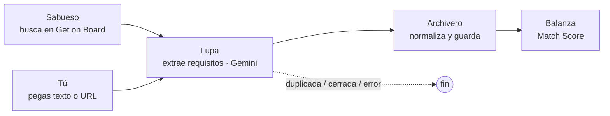
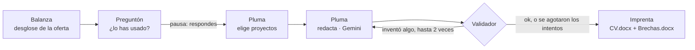

# Job-Intelligence

Asistente personal de búsqueda de empleo para perfiles de datos en Perú. Busca ofertas en fuentes que lo permiten, extrae sus requisitos con Gemini, calcula qué tanto encajas, adapta tu CV **sin inventar nada** y te dice qué estudiar primero.

Está construido como un sistema de **agentes con una sola tarea cada uno**, orquestados con LangGraph, y corre en local con una app web en React.

> Proyecto personal de José Luis Chuque (Ing. de Sistemas, UNMSM). Lo uso en mi propia búsqueda de prácticas en datos.

---

## El problema

Postular bien a una oferta toma tiempo: leerla, ver qué piden, compararlo con lo que sabes y reescribir el CV con su vocabulario. Hacerlo para muchas ofertas lleva a una de dos cosas: mandar el mismo CV a todas, o "adornar" el CV con cosas que no sabes. Este proyecto automatiza lo mecánico y deja las decisiones en tus manos.

## Qué hace

| Módulo | Qué hace |
|---|---|
| **Analizar oferta** | Pegas el texto (y opcionalmente el link), una URL, o la envías desde el navegador con el marcador "Enviar a Job-Intelligence". Extrae puesto, empresa, área, inglés y cada tecnología con su tipo (obligatoria o deseable), su nivel y la frase de la oferta que lo respalda. |
| **Match Score** | Compara la oferta con tu perfil y da un puntaje de 0 a 100, junto con lo que te falta y lo que tienes en un nivel menor al pedido. |
| **Adaptar CV** | Te pregunta por lo que falta, reescribe tu CV con el vocabulario de la oferta y genera dos Word: el **CV listo para enviar** y un **informe de brechas** con qué estudiar y cómo abordarlo en la entrevista. |
| **Bandeja** | Ofertas nuevas que se buscaron solas en Get on Board, ordenadas por Match Score. |
| **Postulaciones** | Estado de cada oferta (Postulada, Entrevista…) con su historial, y **cada versión del CV generada**: al postular queda marcada cuál enviaste, para saber qué tiene la empresa si te llaman. |
| **Qué estudiar** | Ranking de lo que te conviene aprender según tus ofertas, y un plan de estudio con un proyecto por tecnología. |
| **Agentes en vivo** | Al analizar una oferta o adaptar el CV, ves a cada agente trabajar en tiempo real: cuándo empieza, qué hizo y cuánto tardó (Lupa extrae, Validador rechaza y Pluma corrige…). La página *Agentes* muestra el equipo, los flujos y su actividad reciente. Son los eventos reales de LangGraph transmitidos con Server-Sent Events, no una animación. |
| **Rutina diaria** | Todas las mañanas busca ofertas, arma un resumen y te avisa con una notificación de Windows. Los lunes actualiza el plan de estudio. |

## Arquitectura

Cada agente tiene **una tarea fija**, con entradas y salidas definidas. Batuta, el orquestador, los conecta en dos grafos de LangGraph.

**Flujo 1: registrar una oferta**



**Flujo 2: adaptar el CV** (con pausa para que respondas)



| Agente | Tarea | ¿Usa Gemini? |
|---|---|---|
| **Batuta** | Orquesta los flujos, las pausas y los reintentos (LangGraph, estado guardado en SQLite) | No |
| **Sabueso** | Busca ofertas en fuentes permitidas, filtra por país, título y seniority, y deduplica | No |
| **Lupa** | Extrae los requisitos con structured output y enums cerrados | Sí |
| **Archivero** | Une tecnologías y empresas con el catálogo (alias, nombre canónico o creación marcada para revisión) | No |
| **Balanza** | Calcula el Match Score y las brechas | No |
| **Preguntón** | Pregunta por cada requisito que no está en tu perfil ni en tu CV, y recuerda tus respuestas | No (plantilla) |
| **Pluma** | Elige y ordena proyectos (Python) y reescribe los textos (Gemini) | Sí |
| **Imprenta** | Genera los DOCX con python-docx | No |
| **Centinela** | Resumen diario, recordatorios de seguimiento y notificación de Windows | No |
| **Brújula** | Calcula qué estudiar primero; Gemini solo redacta el plan | Solo el plan |

La interfaz (React) habla solo con la API REST de FastAPI, y la API solo llama a `app/services.py`. Por eso pasar de Streamlit a React no tocó los agentes ni sus tests.

## Decisiones de diseño

- **Si algo se puede calcular, no lo decide el LLM.** El Match Score, la fuente de una oferta, si una tecnología ya existe, qué proyectos van en el CV y qué estudiar primero se calculan en Python. Gemini solo hace lo que es juicio sobre texto: extraer requisitos y redactar.
- **Fórmula del Match Score:** `Σ(peso × crédito) / Σ(peso) × 100`. El peso es 1.0 si la tecnología es obligatoria y 0.5 si es deseable. El crédito es 1.0 si la tienes en el nivel pedido, 0.7 si la tienes en un nivel menor y 0 si no la tienes. El denominador lo define la oferta, así que saber cosas que no piden no sube el puntaje.
- **Pluma no puede inventar.** Solo recibe índices de tus proyectos, así que no puede cambiar nombres, empresas ni fechas. Un validador rechaza el texto si menciona una tecnología que no tienes, una cifra que no está en tu CV o si cambia la estructura. Si después de 2 correcciones sigue fallando, el CV sale con **tus textos originales** y el informe explica por qué.
- **Preguntar antes de escribir.** Lo que la oferta pide y no está en tu CV se pregunta. Solo lo que confirmas puede aparecer en el CV.
- **Prioridad de estudio:** `demanda × distancia × tendencia`. La demanda mide cuántas ofertas la piden; la distancia, si te falta (1), si la tienes en un nivel menor (0.5) o si está en tu CV pero no en tu perfil (0.25). La tendencia compara los últimos 30 días con los 30 anteriores, y solo cuenta si cada periodo tiene al menos 5 ofertas.
- **Datos personales fuera del repo:** el CV base, tus respuestas, los documentos generados y el `.env` están en `.gitignore`. El repo solo trae una plantilla con datos ficticios.

## Cómo correrlo

**Requisitos:** Node.js 20+ (para compilar el frontend), Python 3.13, una base PostgreSQL (yo uso Supabase) y una API key de Gemini.

```bash
python -m venv venv
venv\Scripts\activate          # en Windows
pip install -r requirements.txt
copy .env.example .env         # y completa GEMINI_API_KEY y SUPABASE_DB_URL
```

De dónde sacar los dos valores del `.env` (ambos son gratuitos):
- **`GEMINI_API_KEY`:** entra a [Google AI Studio](https://aistudio.google.com/apikey) con tu cuenta de Google y crea una API key. El plan gratuito alcanza para el uso diario.
- **`SUPABASE_DB_URL`:** crea un proyecto en [Supabase](https://supabase.com), pulsa **Connect** arriba del panel y copia la cadena de conexión (*Session pooler*, empieza con `postgresql://`). Reemplaza `[YOUR-PASSWORD]` por la contraseña que elegiste al crear el proyecto. Los scripts SQL del paso 1 se pueden pegar y ejecutar en el **SQL Editor** de Supabase.

1. **Base de datos:** corre en orden `sql/schema_supabase_V1.sql`, `sql/001_revision_y_alias_empresa.sql` y `sql/002_fuente_getonbrd.sql`.
2. **Tu CV:** copia `data/cv_base.example.yaml` como `data/cv_base.yaml` y complétalo. Pon todo lo que hayas hecho, aunque no quepa en una página: Pluma elige qué mostrar para cada oferta.
3. **Tu perfil:** declara tus habilidades desde la página *Mi perfil* o con `python -m scripts.cargar_mi_perfil`.
   - **Qué ofertas busca Sabueso:** edita `config/sabueso.yaml`. Viene configurado para prácticas de datos en Perú; cambia `consultas` (qué se busca), `paises` (como los escribe Get on Board, por ejemplo `[Argentina]`), `incluir_remoto` y `palabras_clave_titulo` (palabras que debe tener el título) según los puestos que te interesen.
4. **La app:**
   ```bash
   python -m scripts.iniciar
   ```
   Abre `http://localhost:8000`: el mismo servidor sirve la app, la API y el endpoint del marcador del navegador. La primera vez compila el frontend (y después, cada vez que cambia). Las instrucciones para instalar el marcador están en *Analizar oferta*.
5. **Opcional:**
   - Desarrollar el frontend con recarga en vivo: `npm run dev` dentro de `web/` (abre `http://localhost:5173`; necesita el servidor de Python corriendo).
   - Rutina diaria a mano: `python -m scripts.rutina_diaria`.
   - Programarla en Windows: `powershell -ExecutionPolicy Bypass -File scripts\programar_tarea.ps1`.
6. **Tests:** `pytest`

## Estructura

```
app/
  agents/      Batuta, Sabueso, Lupa, Archivero, Balanza, Preguntón, Pluma, Imprenta, Centinela, Brújula
  fuentes/     adaptadores de fuentes de ofertas (Get on Board)
  cv/          CV base, respuestas del Preguntón e historial de CVs enviados
  services.py  lo único que usan las interfaces
  consultas.py lecturas y cambios simples para la app
  main.py      servidor: sirve la app (web/dist), /recibir del marcador y /analyze-job
  api.py       API REST /api que usa el frontend
  pendientes.py ofertas enviadas desde el navegador, a la espera de revisión
web/           frontend: React + Vite + Tailwind + TanStack Query + Recharts
  src/pages/   una página por sección (Inicio, Bandeja, Analizar, Postulaciones, Adaptar CV...)
config/        qué busca Sabueso
sql/           esquema y migraciones
scripts/       iniciar (app + API), rutina diaria, tarea programada y pruebas manuales
tests/         144 tests
```

## Stack

Python 3.13 · LangGraph (+ checkpointer SQLite) · Gemini (`google-genai`, structured output) · Pydantic · PostgreSQL / Supabase (psycopg2) · React + Vite + Tailwind CSS + Recharts · FastAPI · python-docx · BeautifulSoup · pytest

## Limitaciones

- **Una sola fuente automática.** Las ofertas de LinkedIn, Bumeran o Computrabajo se pegan a mano.
- **Muestra chica.** Los hallazgos de demanda son de mis ofertas, no del mercado.
- **Cuota de Gemini.** El plan gratuito tiene un tope diario por modelo, aunque repartirlo entre agentes lo alarga.
- **Solo en local y para un usuario.** No tiene login; no está pensado para desplegarse así.

